# 产品简介｜mit-assets-admin

> 文档类型：产品简介 · 应用版本：`2.9.2` · 更新时间：2026-11-27 · 适用读者：产品、设计、研发、交付与运维

---

## 1. 一句话定位

**mit-assets-admin** 是面向企业内部的资产与业务运营平台，把资产档案、流转单据、发票证据、文档协作、日程公告、权限审计与受控智能分析收拢到同一条可追溯业务链路中。

| 维度 | 说明 |
| --- | --- |
| 产品形态 | Web 管理后台，桌面端优先，兼顾窄桌面与移动端基础操作 |
| 核心对象 | Asset、Asset Operation、Invoice、Evidence File、Document、Schedule、Announcement、User、Role、Tenant、Department |
| 主要用户 | 资产管理员、财务 / 票据人员、系统管理员、审计人员、内部运营人员 |
| 交付形态 | Go / Gin 服务端 + Vue 3 Web 端，Docker Compose 部署，PostgreSQL / Redis / S3 兼容对象存储作为外部依赖 |
| 成功标准 | 日常登记、审核、查询和统计在一个系统内完成；每条状态变化都有业务单据、证据或审计记录可追溯 |

---

## 2. 用户与核心价值

| 角色 | 典型工作 | 系统提供的能力 |
| --- | --- | --- |
| 资产管理员 | 建档、入库、领用、调拨、归还、维修、报废、风险处置 | 分类 / 位置字典、六类业务单、状态机、前后快照、照片与价值统计、风险事件清单 |
| 财务 / 票据人员 | 上传发票、复核字段、验真、分类、确认、查看流水 | 批量上传、OCR / 多模态识别、人工复核、验真历史、分类规则、防重、整数分金额统计 |
| 文档管理员 | 上传资料、预览、维护在线内容 | 多格式预览、在线编辑版本、原始文件与编辑内容分离、对象存储代理 |
| 公告与日程使用者 | 发布公告、安排提醒、查看通知 | 公告草稿 / 发布 / 附件 / 已读、SSE 通知、个人日程、重复规则、提醒收件箱 |
| 系统管理员 | 用户、角色、菜单、API、按钮权限与运行配置 | JWT + Casbin、品牌外观、SMTP、AI Provider、联系方式验证、配置版本、接口令牌 |
| 审计人员 | 追溯业务变更与登录行为 | 操作历史、登录日志、错误日志、不可变流转快照、日报投递记录 |

**价值链**：业务录入 → 证据留存 → 人工确认 → 状态流转 → 聚合统计 → 审计追溯。自动识别与模型输出只生成候选结果，正式业务记录由人工确认与服务端规则写入。

---

## 3. 界面导览

下列截图来自仓库保留的线上生产界面，采集于 **2026-08-21**；点击可查看原图。截图中的统计数字与账号信息属于演示数据，品牌名称、图标和背景由部署环境中的品牌配置决定。

  

桌面端登录页：品牌插画与登录表单左右分栏，展示可配置的系统名称、Logo 与背景。

### 3.1 资产运营主线

| 首页驾驶舱 | 资产档案 |
| --- | --- |
| [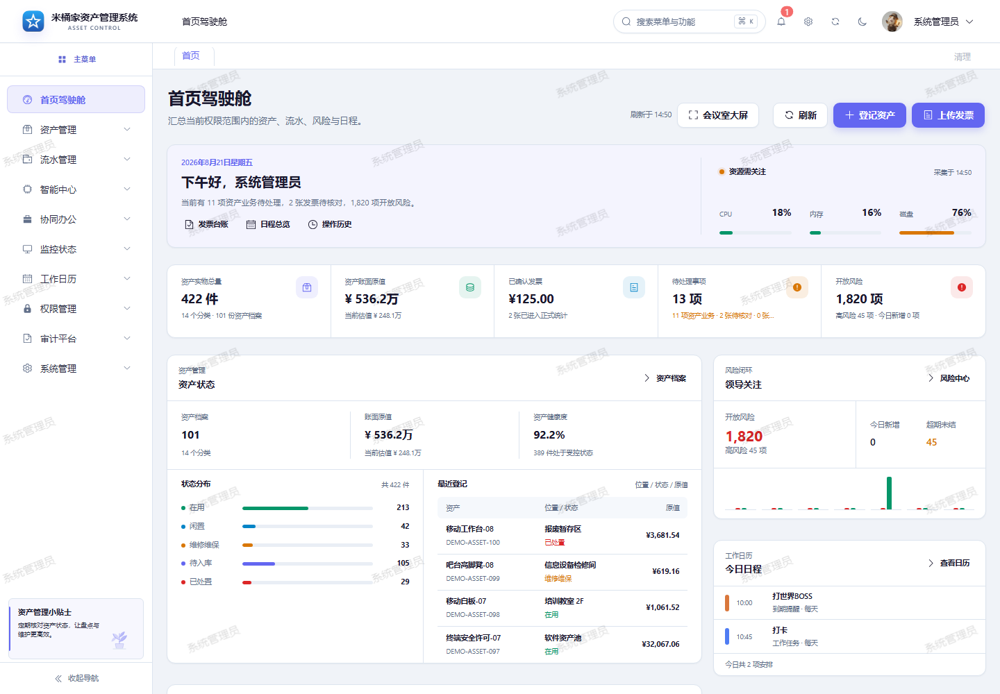](docs/images/readme/02-dashboard.png) | [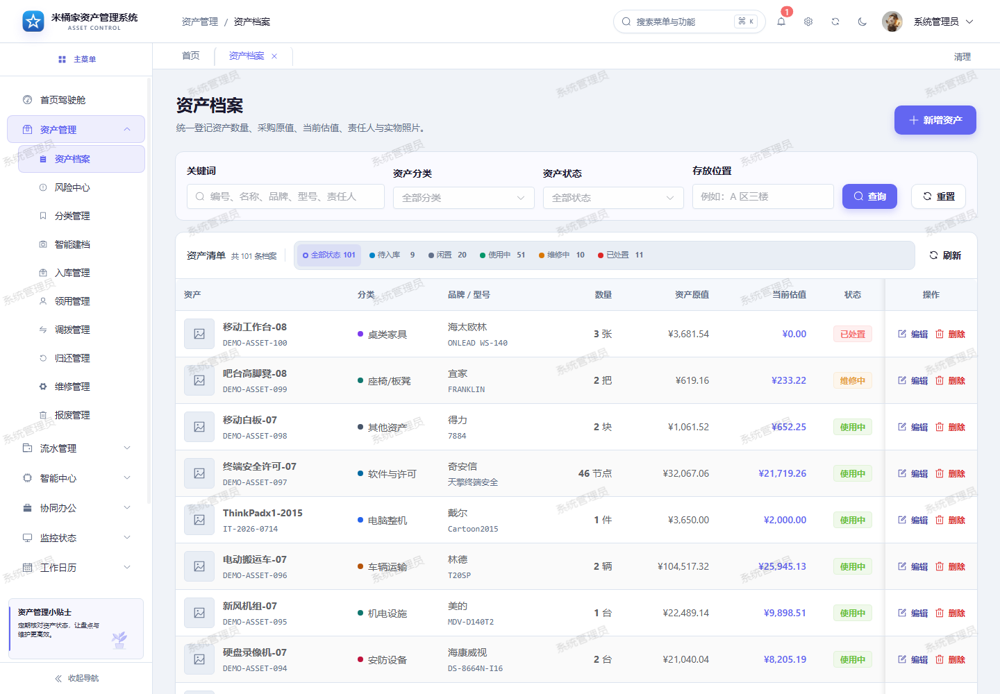](docs/images/readme/asset-inventory.png) |
| 资产、发票、待办、风险、日程与资源状态一屏汇总 | 关键词、分类、状态、位置筛选；数量、原值、当前估值与操作入口 |

| 入库管理 | 资产风险中心 |
| --- | --- |
| [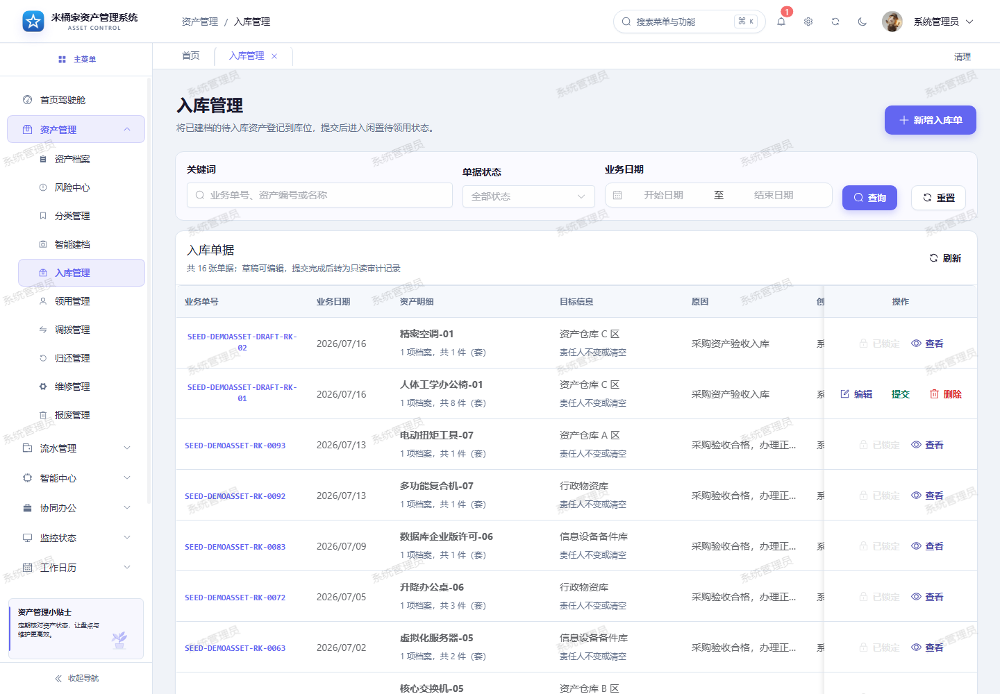](docs/images/readme/asset-inbound.png) | [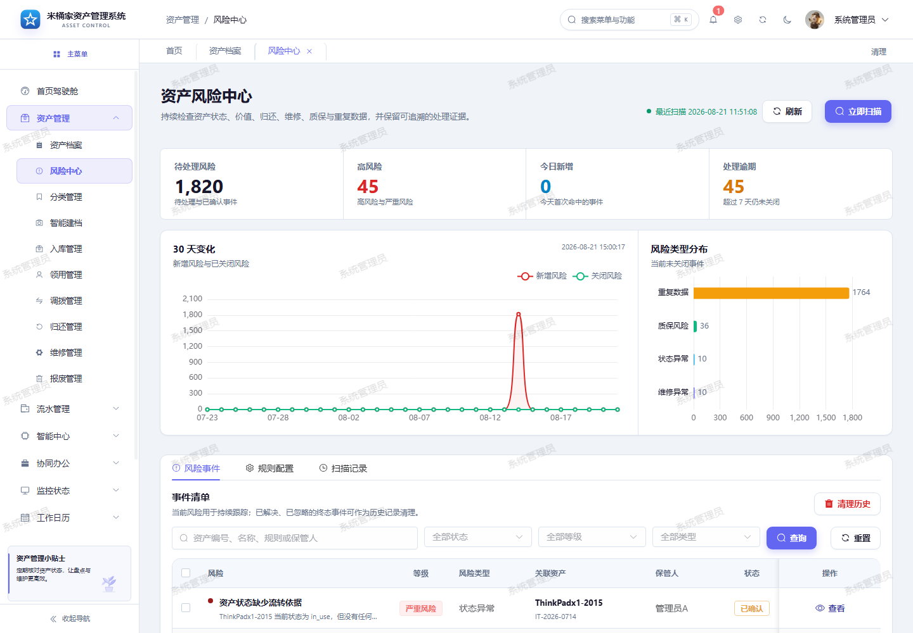](docs/images/readme/asset-risk.png) |
| 草稿可编辑，提交后转为只读审计记录 | 风险趋势、类型分布、规则配置、扫描记录与事件处置 |

### 3.2 票据与协作主线

| 流水总览 | 发票台账 |
| --- | --- |
| [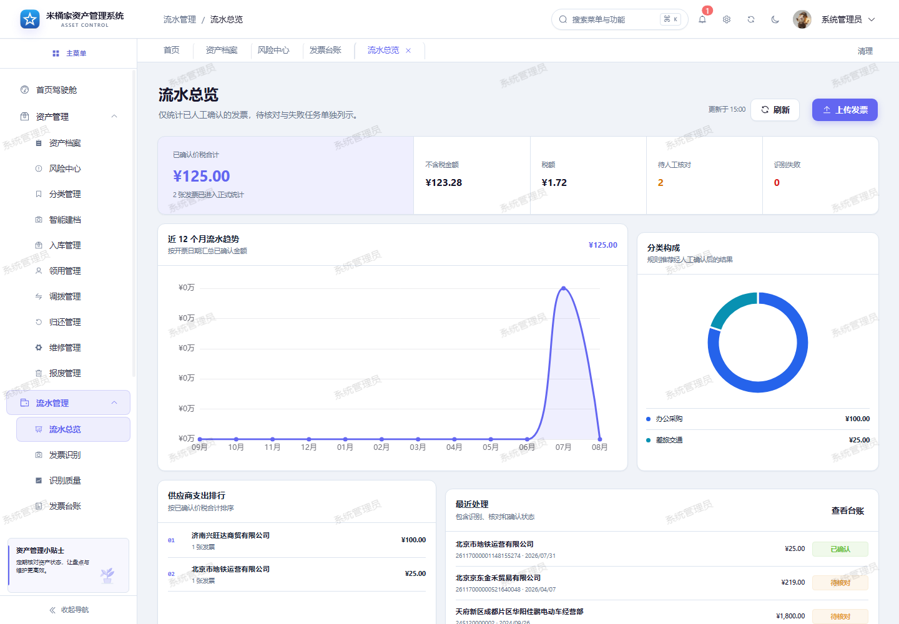](docs/images/readme/invoice-dashboard.png) | [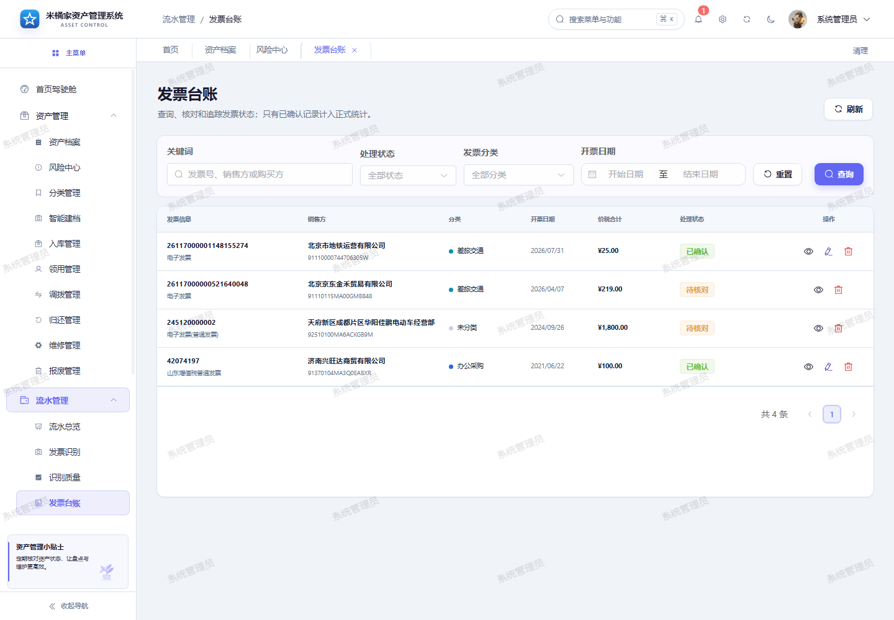](docs/images/readme/invoice-ledger.png) |
| 已确认金额、趋势、分类构成、供应商支出与最近处理 | 识别状态、复核、确认、分类、金额与证据追踪 |

| 文档管理 | 工作日历 |
| --- | --- |
| [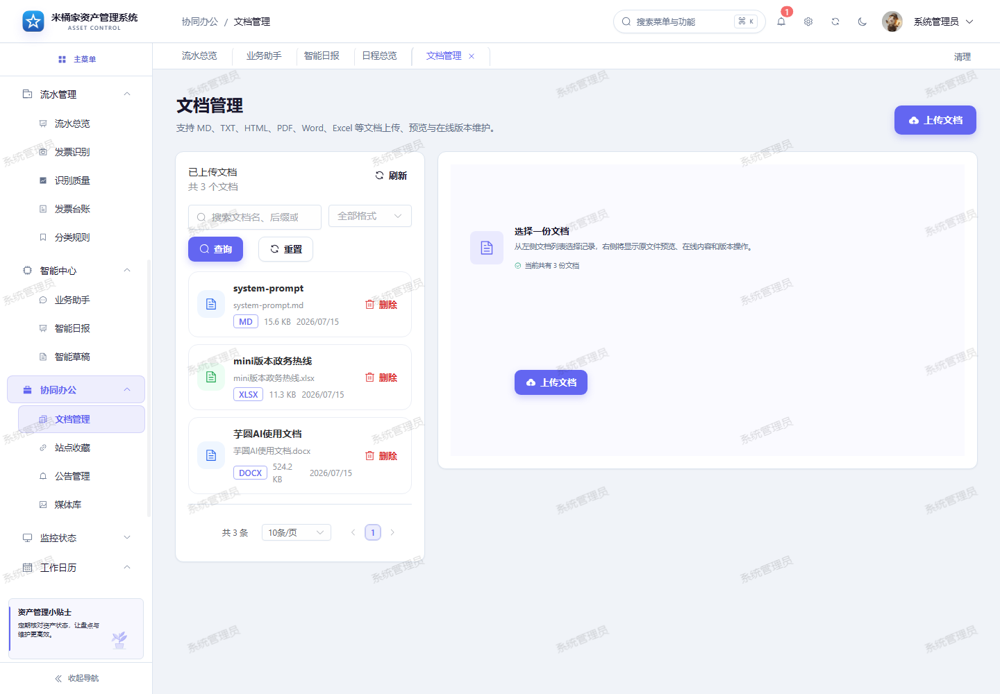](docs/images/readme/documents.png) | [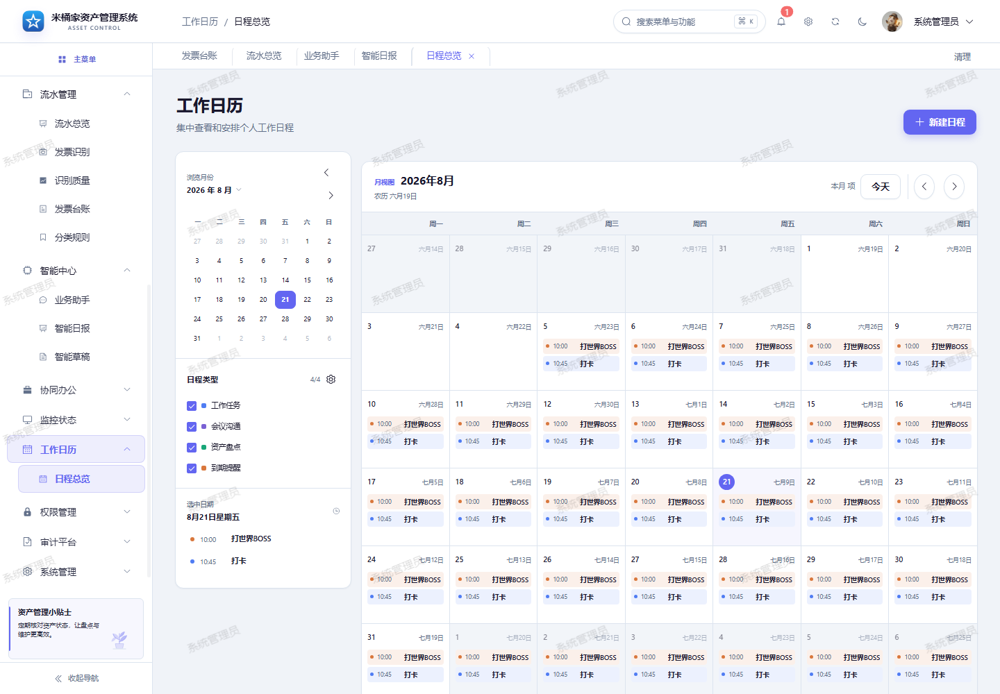](docs/images/readme/calendar.png) |
| MD、TXT、HTML、PDF、Word、Excel 上传、预览与在线版本维护 | 月历视图、日程类型过滤、当天安排与重复日程 |

### 3.3 智能中心与治理

| 业务助手 | 智能日报 |
| --- | --- |
| [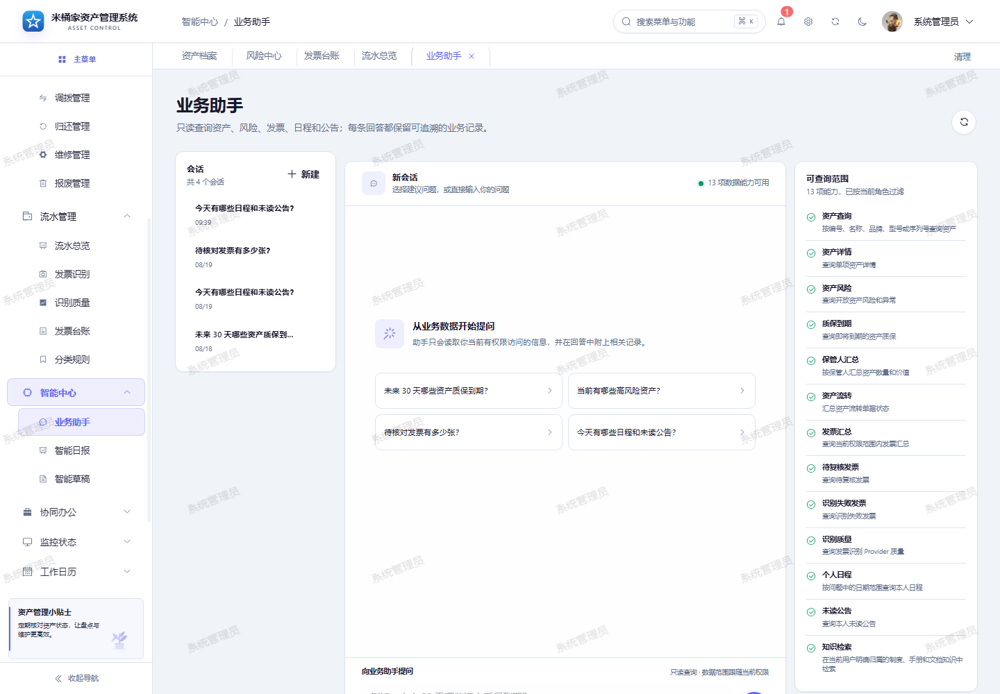](docs/images/readme/smart-copilot.png) | [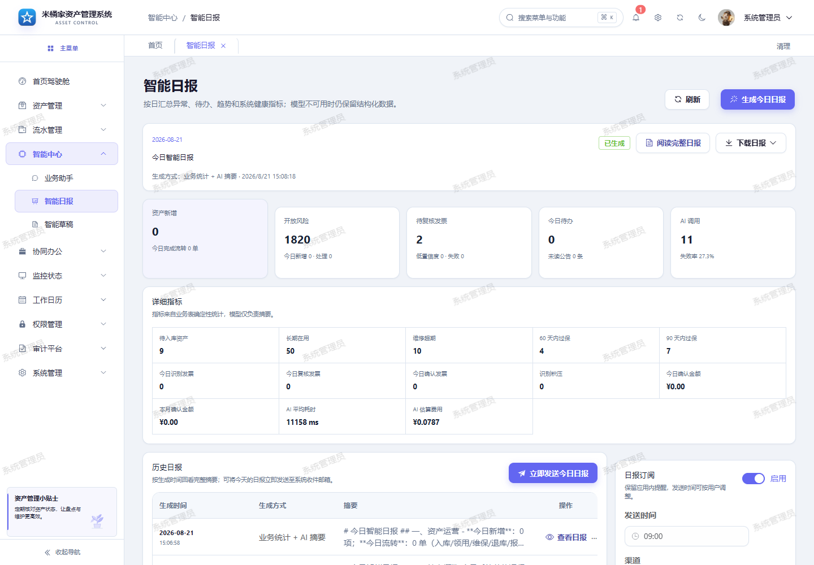](docs/images/readme/smart-report-late.png) |
| 会话、推荐问题、按角色过滤的可查询范围 | 业务指标、AI 摘要、订阅、站内 / 邮件投递与导出 |

| 智能草稿 | 用户管理 |
| --- | --- |
| [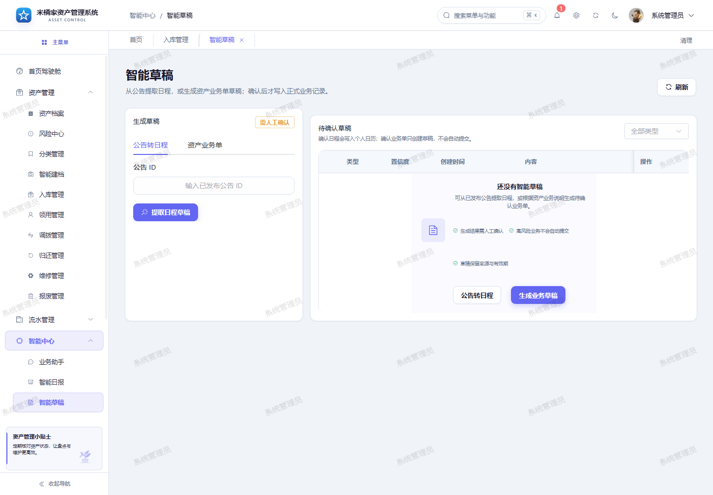](docs/images/readme/smart-drafts.png) | [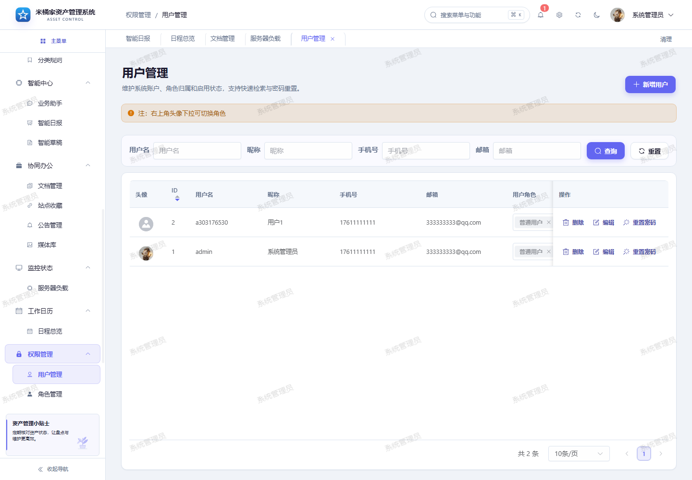](docs/images/readme/user-management.png) |
| 公告提取日程、资产业单草稿，人工确认后生效 | 账户、角色归属、启停状态、检索与密码重置 |

  

900×900 窄桌面登录页：登录表单保持完整，品牌插画按视口裁切。

> 更多界面状态、智能日报投递记录与服务器负载截图保留在 [GitHub 项目总览](README.md#2-界面一览) 中。

---

## 4. 产品结构

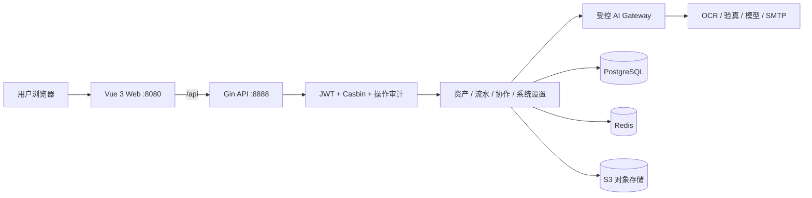

| 功能域 | 页面入口 | 业务规则要点 |
| --- | --- | --- |
| 首页驾驶舱 | 首页 | 聚合当前权限范围内的资产、流水、风险、日程与系统状态 |
| 资产管理 | 资产档案 / 分类管理 / 六类业务单 / 风险中心 / 智能建档 | 新建档案为 `pending_inbound`；业务单提交锁定资产、事务内校验状态、写入前后快照 |
| 流水管理 | 流水总览 / 发票识别 / 发票台账 / 分类规则 / 识别质量 | 金额以整数分保存；只有 `confirmed` 发票进入正式统计；已确认发票需重开后编辑 |
| 协同办公 | 文档管理 / 站点收藏 / 公告管理 / 媒体库 | 原始文件与在线内容分离；公告在线 SSE、离线补偿读取；日程按用户隔离 |
| 工作日历 | 日程总览 | 日 / 周 / 月重复规则，以“用户 + 日程 + 发生时间”幂等生成提醒 |
| 智能中心 | 业务助手 / 智能日报 / 智能草稿 | 受控 Business Tool 查询实时业务数据；草稿人工确认；日报按类型投递与记录 |
| 监控状态 | 服务器负载 | CPU、内存、磁盘、负载趋势、Go runtime、Goroutine 与运行环境 |
| 权限与审计 | 用户 / 角色 / API / 菜单 / 操作历史 / 登录日志 / 错误日志 | 菜单可见与 API 可调用分别授权；页面身份以服务端认证上下文为准 |
| 系统管理 | 基础数据 / 平台设置 / 开放与运维 / 智能服务 | 字典、参数、登录外观、运行配置、接口令牌、配置版本与 AI 能力配置 |

完整信息架构、状态枚举与业务流程见 [产品说明书](docs/PRODUCT-MANUAL.md)；功能验收口径见 [功能规格说明](docs/FUNCTIONAL-SPECIFICATION.md)。

---

## 5. 设计原则

1. **任务与状态优先**：页面先呈现当前业务对象、处理阶段、待办与证据，再呈现辅助图表。
2. **高密度数据可读**：通过固定列宽、对齐、状态标签、分页和一致的控件词汇保持表格可扫描。
3. **自动结果可解释、可回退**：识别置信度、风险证据、AI 查询条件、草稿来源与有效期均展示给复核者。
4. **权限与审计进入工作流**：菜单、API、按钮、数据范围与操作记录按同一身份链路判断。
5. **一套视觉与交互语言**：跨模块复用颜色语义、表单、抽屉、状态标签、分页和空 / 失败状态。
6. **外观可配置**：系统名称、副标题、Logo、登录背景、主题模式和明暗色由管理员设置。

### 视觉与体验基线

- 克制、专业、适合长时间办公；避免深色指挥中心风格、营销式大标题、装饰性仪表盘与彩虹图表。
- 状态同时用文字、图标与颜色表达；键盘可达、焦点可见、对比度可读、支持减少动态效果。
- 桌面、900×900 窄桌面和移动端基础可用；加载、空数据、失败、无权限与长文本均有明确界面状态。
- 详细令牌与组件约定见 [FRONTEND-STYLE.md](FRONTEND-STYLE.md) 与 [design-system/](design-system/)。

---

## 6. 边界与演进

| 当前能力边界 | 说明 |
| --- | --- |
| 业务助手 | 只读受控 Tool；实时数据不复制进知识库；事实由数据库查询返回，模型仅解析条件与润色表达 |
| 知识库 | 按 Tenant / Department / User / Role 归属的文本分片索引，来源由后端集成或业务流程显式写入 |
| 报告邮件 | 服务端按 `reportType` 解析收件人、主题与正文，客户端不构造任意发信内容 |
| 资产流转 | 当前以整条资产档案为流转单位，不拆分部分数量 |
| 编排实现 | `server/plugin/smart/service` 的规则规划器 + 可选模型条件解析 + Tool Registry，不依赖 LangGraph 运行时 |

后续方向：统一各业务插件的 Tenant / Department / Data Scope 迁移、扩展报告提供器、用真实业务数据校准风险阈值与识别质量、补齐跨角色负向权限测试和移动端视觉回归证据。尚未形成完整业务闭环的盘点 / RFID、折旧会计、审批流、采购供应链、正式财务凭证、团队共享日历与多人实时文档协作，在领域模型与验收口径明确后分阶段开放。

---

## 7. 关联文档

| 文档 | 用途 |
| --- | --- |
| [GitHub 项目总览](README.md) | 完整截图、能力矩阵、架构、部署、测试与文档索引 |
| [产品说明书](docs/PRODUCT-MANUAL.md) | 用户角色、功能范围、业务流程、数据口径与验收项 |
| [用户使用手册](docs/USER-GUIDE.md) | 页面操作与常见问题 |
| [功能规格说明](docs/FUNCTIONAL-SPECIFICATION.md) | 业务规则与状态机 |
| [系统架构说明](docs/ARCHITECTURE.md) | 分层、插件、权限与数据流 |
| [部署运维手册](docs/DEPLOYMENT.md) | 环境变量、升级、备份与回滚 |
| [文档中心](docs/README.md) | 按角色组织的阅读路径 |
