# mit-assets-admin · 企业内部资产与业务运营平台

> 一套把**资产档案、流转单据、发票证据、文档协作、日程公告、权限审计与智能分析**放在同一条可追溯业务链路里的管理系统。前端为 Vue 3，服务端为 Go / Gin，支持 Docker Compose 部署与发布验收。

**当前版本：`2.9.2`** · 版本来源：[web/package.json](web/package.json)、[server/global/version.go](server/global/version.go) · 文档更新：2026-11-27

| 快速入口 | 内容 |
| --- | --- |
| [产品简介](PRODUCT.md) | 面向产品、设计与交付的一页式定位说明 |
| [产品说明书](docs/PRODUCT-MANUAL.md) | 用户角色、功能范围、业务流程、数据口径与验收条件 |
| [用户使用手册](docs/USER-GUIDE.md) | 日常操作步骤 |
| [功能规格说明](docs/FUNCTIONAL-SPECIFICATION.md) | 业务规则、状态机与权限矩阵 |
| [API 接口文档](docs/API.md) | 鉴权、统一响应与接口清单 |
| [部署运维手册](docs/DEPLOYMENT.md) | 环境变量、升级、备份、回滚与故障处理 |
| [文档中心](docs/README.md) | 按角色组织的完整阅读路径 |

---

## 1. 一眼看懂

- **一条资产主线**：建档 → 入库 → 领用 / 调拨 / 归还 / 维修 → 报废；每次提交保留前后快照。
- **一条票据主线**：上传 → OCR / 多模态识别 → 人工复核 → 验真与分类 → 确认 → 正式统计。
- **一套协作面**：文档、工作日历、公告、站点收藏与 SSE 通知，减少多系统来回切换。
- **一层治理面**：JWT、Casbin、菜单 / API / 按钮权限、操作记录、登录日志、错误日志与数据清理。
- **一组受控智能能力**：智能建档、风险中心、业务助手、智能日报、智能草稿和 AI 运行观测；实时业务数据通过受控 Business Tool 查询。

系统名称、登录图标、背景图库与主题模式可在系统设置中调整。仓库截图展示的是已配置品牌外观的界面；代码默认名称为 `mit-assets-admin`，默认副标题为 `ASSET CONTROL`。

---

## 2. 界面一览

> 以下为仓库保留的线上界面截图，采集于 **2026-08-21**。点击图片可打开原图。页面中的账号、金额、日期和统计值属于演示数据，界面品牌与外观以实际部署配置为准。

### 2.1 登录与响应式

<p align="center">
  <a href="docs/images/readme/production-login.png">
    
  </a>
</p>

| 视口 | 截图 | 布局说明 |
| --- | --- | --- |
| 1440×1000 桌面端 | [打开桌面登录原图](docs/images/readme/production-login.png) | 左侧品牌插画，右侧登录表单，信息层级与留白按宽屏展开 |
| 900×900 窄桌面 | [打开窄桌面登录原图](docs/images/readme/production-login-tablet.png) | 登录区保持完整可用，品牌图在窄视口下裁切展示 |

<p align="center">
  <a href="docs/images/readme/production-login-tablet.png">
    
  </a>
</p>

### 2.2 工作台与资产全生命周期

| 首页驾驶舱 | 资产入库 |
| --- | --- |
| [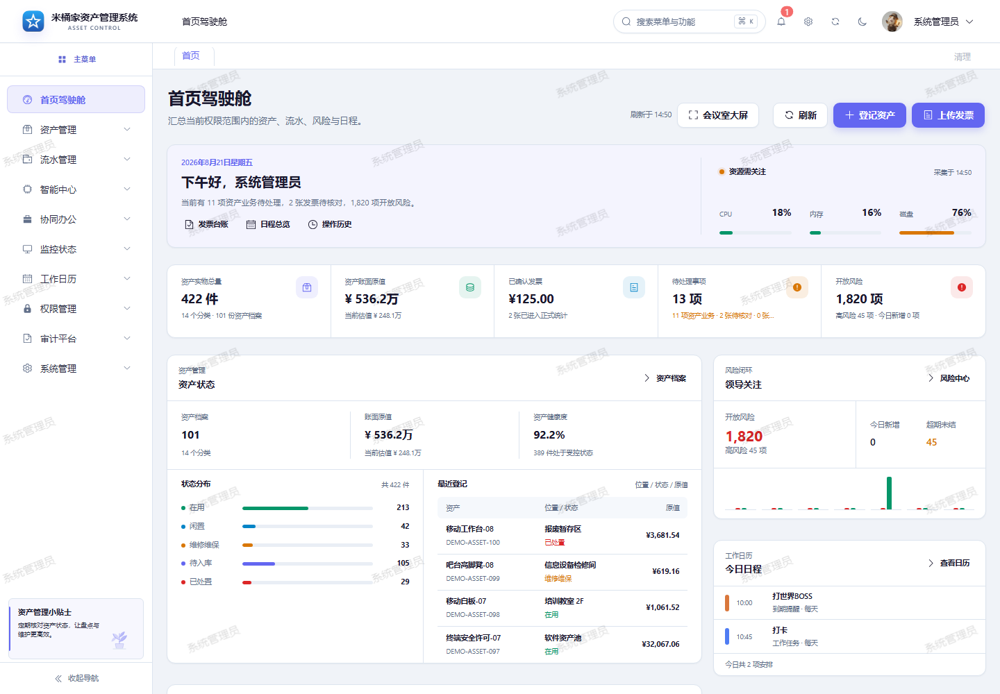](docs/images/readme/02-dashboard.png) | [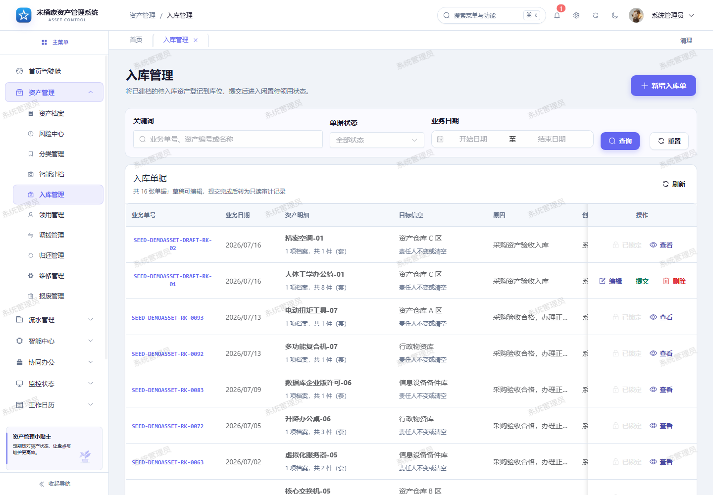](docs/images/readme/asset-inbound.png) |
| 聚合资产、发票、待办、风险、日程与系统资源摘要 | 草稿编辑、提交后转为只读审计记录 |

| 资产档案 | 资产风险中心 |
| --- | --- |
| [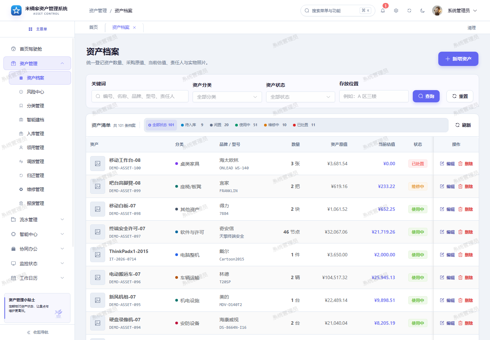](docs/images/readme/asset-inventory.png) | [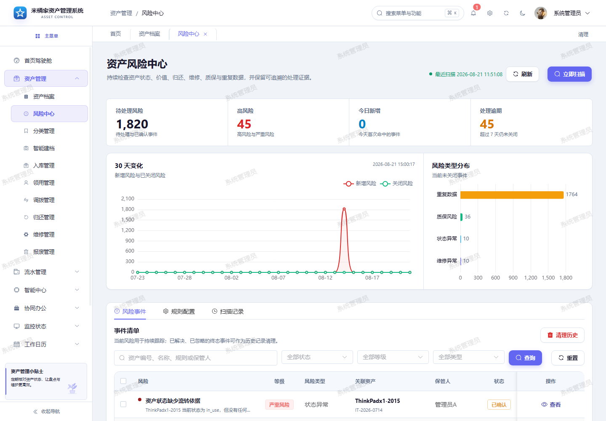](docs/images/readme/asset-risk.png) |
| 按关键词、分类、状态、位置筛选档案，查看数量、原值与当前估值 | 风险趋势、类型分布、事件清单、规则配置与扫描记录 |

### 2.3 票据、文档与协同办公

| 流水总览 | 发票台账 |
| --- | --- |
| [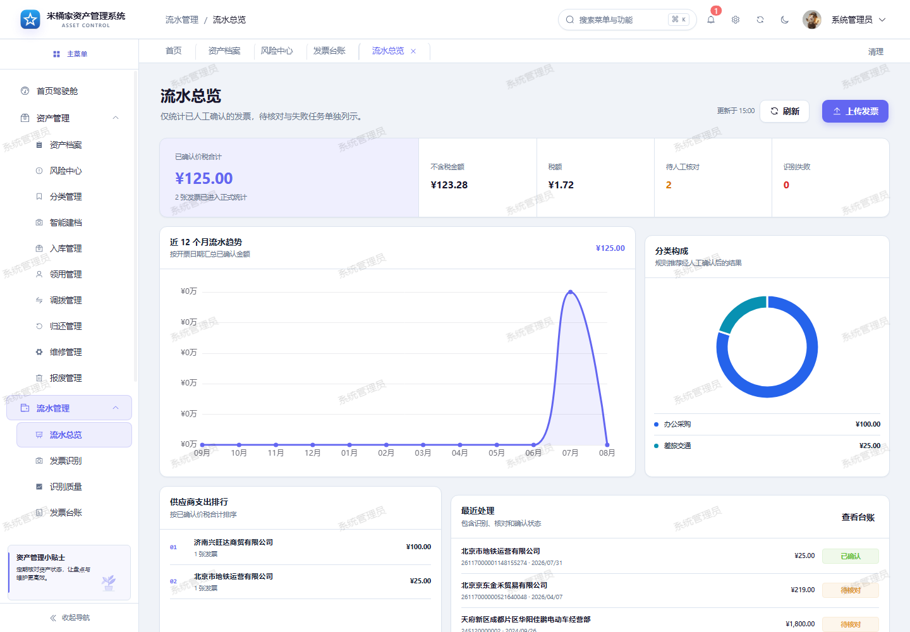](docs/images/readme/invoice-dashboard.png) | [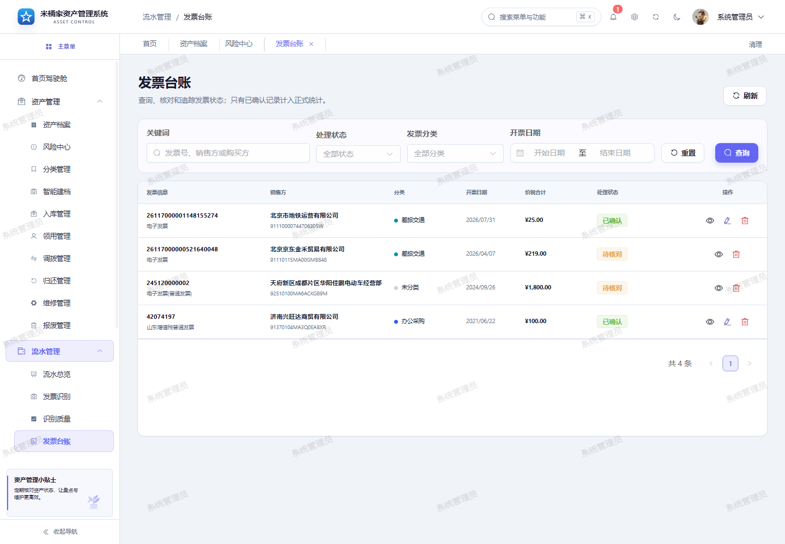](docs/images/readme/invoice-ledger.png) |
| 已确认金额、趋势、分类构成、供应商支出与最近处理 | 发票识别、复核、确认、分类和证据追踪 |

| 文档管理 | 工作日历 |
| --- | --- |
| [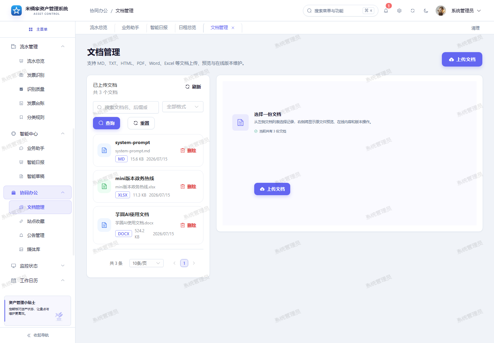](docs/images/readme/documents.png) | [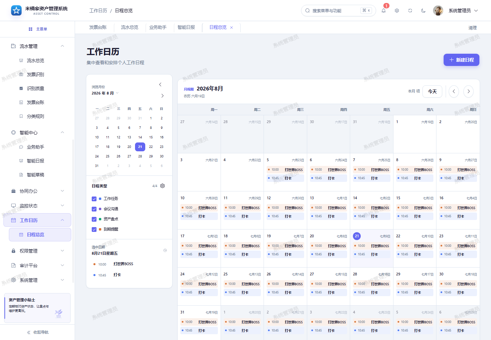](docs/images/readme/calendar.png) |
| 多格式文件上传、预览与在线版本维护 | 月历、日视图、日程类型过滤与重复日程 |

### 2.4 智能中心与平台治理

| 业务助手 | 智能草稿 |
| --- | --- |
| [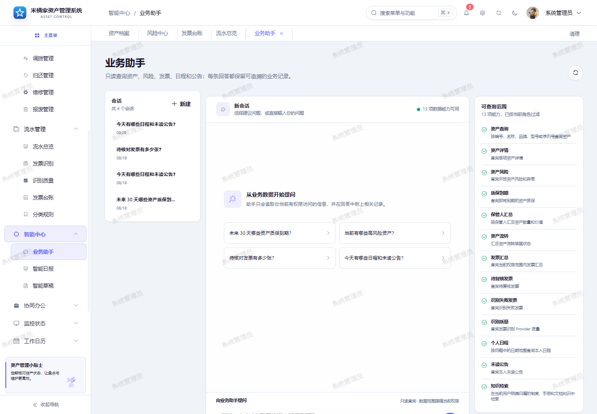](docs/images/readme/smart-copilot.png) | [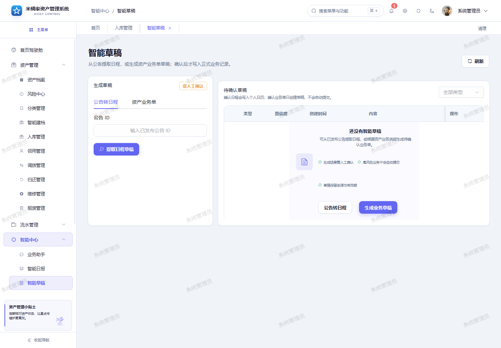](docs/images/readme/smart-drafts.png) |
| 会话、推荐问题与按角色过滤的可查询范围 | 公告提取日程、资产业单草稿，人工确认后写入正式记录 |

| 智能日报订阅视图 | 智能日报投递记录视图 |
| --- | --- |
| [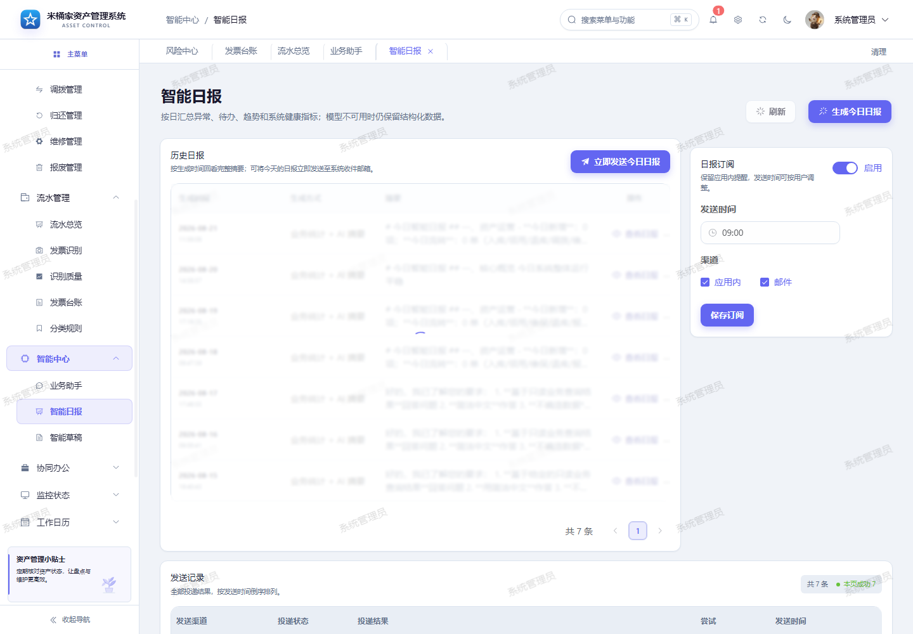](docs/images/readme/smart-report.png) | [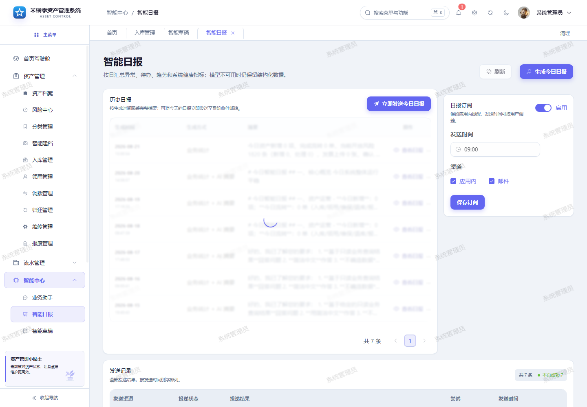](docs/images/readme/smart-report-final.png) |
| 历史日报加载、订阅设置、站内与邮件投递入口 | 投递记录、订阅设置与列表加载状态 |

| 智能日报生成结果 | 服务器负载 |
| --- | --- |
| [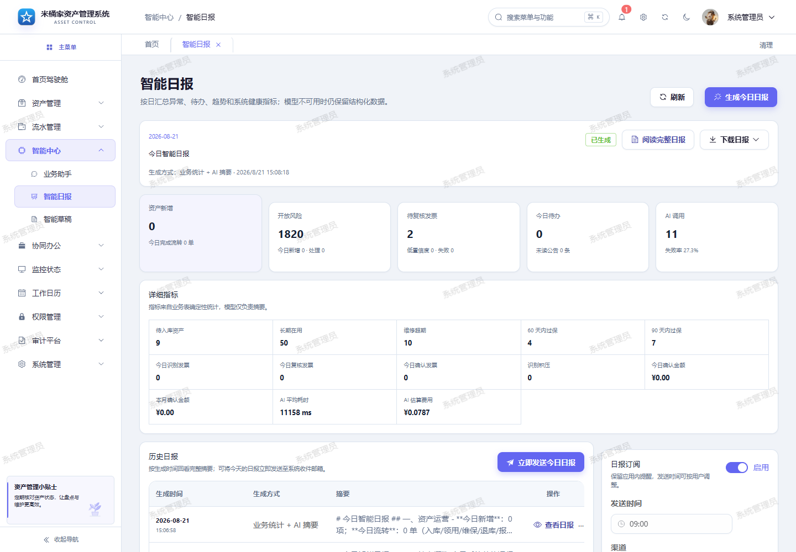](docs/images/readme/smart-report-late.png) | [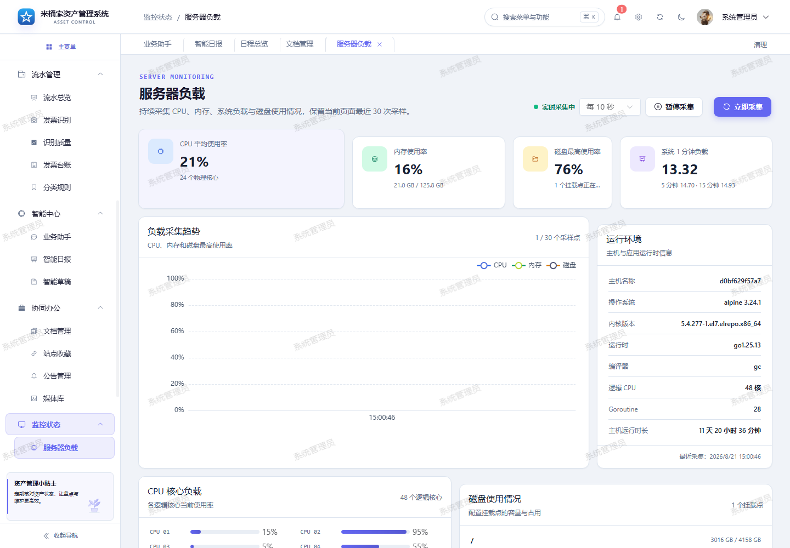](docs/images/readme/server-monitor.png) |
| 生成方式、详细指标、历史记录与下载入口 | CPU、内存、磁盘、负载趋势、运行环境与 Goroutine 信息 |

<p align="center">
  <a href="docs/images/readme/user-management.png">
    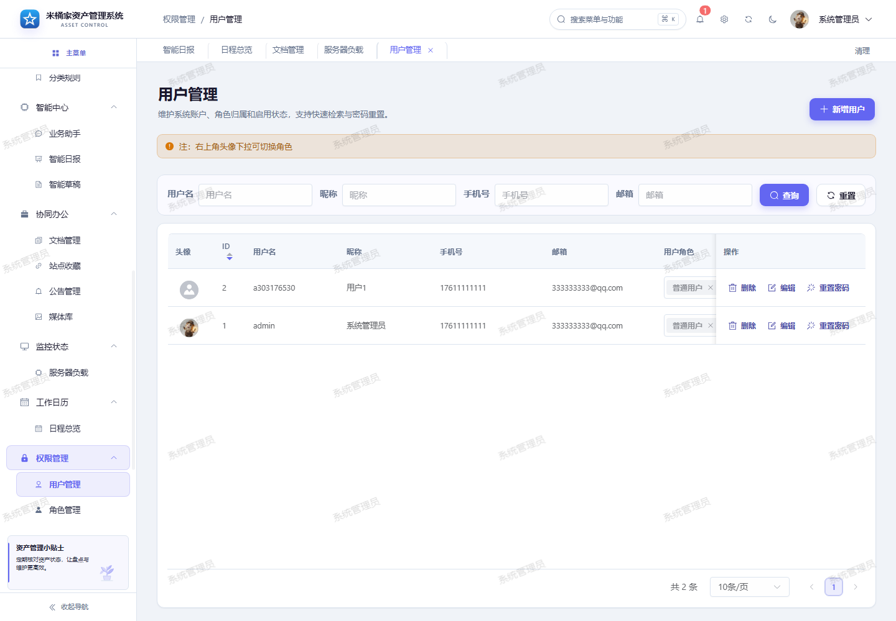
  </a>
</p>

<p align="center"><sub>用户管理：账户、角色归属、启停状态、检索与密码重置；右上角头像菜单支持角色切换。</sub></p>

---

## 3. 产品能力矩阵

| 领域 | 当前能力 |
| --- | --- |
| 首页驾驶舱 | 资产健康度、价值指标、最近登记、流转草稿、发票摘要、当日日程、风险与资源状态 |
| 资产档案 | 分类、位置、照片、供应商、序列号、数量、单位、单价、原值、当前估值、状态与保管人 |
| 资产流转 | 入库、领用、调拨、归还、维修、报废六类业务单；草稿、提交、锁定、事务校验与前后快照 |
| 智能建档 | 多照片 / 铭牌识别、字段置信度、分类映射、序列号去重、人工确认后正式建档 |
| 资产风险 | 确定性规则、定时 / 手动扫描、30 天趋势、类型分布、证据、处理日志、失败续扫与批量清理 |
| 发票与流水 | 单张 / 批量上传、OCR / 多模态识别、人工复核、验真、分类、确认、防重与金额统计 |
| 识别质量 | Provider、模型、文件类型、字段修改、分类接受、失败、耗时与估算费用指标 |
| 文档与媒体 | 对象存储、图片 / 头像、Word、Excel、PDF、Markdown、文本预览与在线版本维护 |
| 协同办公 | 个人日程、重复规则、提醒收件箱、公告发布、已读状态、SSE 实时通知与站点收藏 |
| 系统外观 | 系统名称、登录图标、背景图库、主题模式和品牌配置 |
| 智能中心 | 业务助手、受控 Business Tool、会话、数据引用、知识片段检索与权限过滤 |
| 智能日报 | 当日 / 历史日报、资产 / 风险 / 发票 / 日程 / 公告指标、订阅、站内投递、邮件投递、导出 |
| 智能草稿 | 公告转日程、资产运营业务单草稿、人工确认、过期和并发保护 |
| 平台治理 | JWT、Casbin、菜单 / API / 按钮权限、操作记录、登录日志、错误日志、数据清理与服务器负载 |

### 智能化边界

1. 资产、发票、公告、日程等实时业务数据由受控 Business Tool 查询，业务表不复制进知识库。
2. 知识库是按 Tenant、Department、User、Role 归属的文本分片索引；知识来源由后端集成或业务流程显式写入。
3. 业务助手的入口是已注册、可审计、经过权限检查的 Tool；模型仅负责条件解析与表达润色，事实来自实时查询。
4. 报告邮件接口按服务端支持的 `reportType` 解析收件人、主题与正文；客户端不构造任意发信内容。
5. 当前编排位于 `server/plugin/smart/service`，采用规则规划器、可选模型条件解析与 Tool Registry，不依赖 LangGraph 运行时。资产条件查询支持日期、金额、状态、部门、保管人的组合筛选、排序与统计，详见 [条件查询说明](docs/SMART-ASSISTANT-P0-P3.md#资产条件查询)。

---

## 4. 架构与代码结构

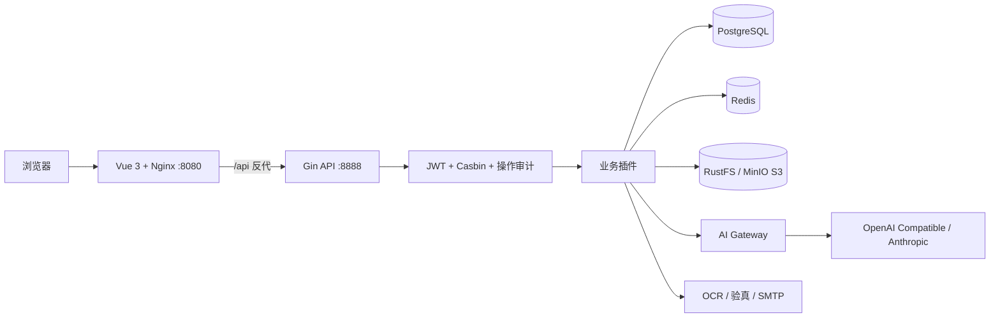

Docker Compose 只负责 `web` 与 `server` 两个应用容器。数据库、缓存和对象存储提前准备，并通过 `.env` 注入连接信息。生产环境由 HTTPS 网关对外提供入口，Web 容器暴露给反向代理。

```text
mit-assets-admin/
├─ server/
│  ├─ ai/                         统一 AI Gateway、Provider、配额、脱敏和调用审计
│  ├─ middleware/                 JWT、Casbin、操作记录、AI 调用策略
│  ├─ initialize/                 配置、GORM、路由、插件和定时任务初始化
│  ├─ model/ api/ router/ service/ 系统公共层与业务路由
│  └─ plugin/
│     ├─ asset/                   资产、流转、智能建档和风险中心
│     ├─ invoice/                 发票、流水和识别质量
│     ├─ smart/                   业务助手、知识检索、日报、邮件和草稿
│     ├─ aioperations/            AI 能力配置、识别服务、配额和运行监控
│     ├─ document/                文档与在线编辑
│     ├─ announcement/            公告与通知
│     ├─ schedule/                日程与提醒
│     ├─ site/                    站点收藏
│     ├─ systemsetting/           登录外观和品牌配置
│     ├─ email/                   SMTP 测试与通用邮件工具
│     └─ auto/ plugin-tool/       自动代码与插件辅助能力
├─ web/                           Vue 3 Web 端
├─ deploy/docker-dev/             Docker Compose、镜像、初始化和发布验收
├─ docs/                          产品、架构、API、数据、开发和运维文档
├─ docs/images/readme/            项目截图
├─ design-system/                 视觉令牌与设计约定
├─ PRODUCT.md                     产品简介
├─ CONTEXT.md                     领域术语和数据边界
└─ FRONTEND-STYLE.md              前端主题与交互规范
```

### 技术栈

- **服务端**：Go `1.25.x`、Gin `1.10.x`、GORM `1.31.x`、PostgreSQL 14–18、Redis 6+、JWT、Casbin `3.10.x`、Zap、Cron、Swagger / Swaggo。
- **Web**：Vue `3.5.x`、Vite `8.x`、Element Plus `2.13.x`、Pinia、Vue Router、Axios、ECharts、Three.js、Vue Office、Mammoth、Marked、WangEditor、XLSX、Sass、UnoCSS。
- **外部能力**：RustFS / MinIO / S3 兼容对象存储、OCR、发票验真、OpenAI Compatible / Anthropic、SMTP。

---

## 5. 快速开始

### 环境要求

Docker Engine 24+、Docker Compose v2、Go `1.25.x`、Node.js 当前 LTS、PostgreSQL 14–18、Redis 6+ 和 S3 兼容对象存储。

### Docker Compose

```bash
cd deploy/docker-dev
cp .env.example .env
chmod 600 .env
# 编辑 .env，替换 change-me 与外部服务地址
chmod +x ./*.sh tools/*.sh
./up.sh
./release-acceptance.sh
```

`up.sh` 会校验配置、生成运行时 `config.yaml`、构建镜像、启动容器、初始化数据库并执行发布验收。

| 服务 | 默认地址 |
| --- | --- |
| Web | `http://<服务器IP>:8080` |
| API | `http://<服务器IP>:8888` |
| Swagger | `http://<服务器IP>:8888/swagger/index.html` |

首次初始化创建 `admin` 用户，密码由 `.env` 中的 `MAA_ADMIN_PASSWORD` 决定。首次登录后立即修改密码并创建日常账号。

### 必填配置示例

```dotenv
MAA_JWT_SIGNING_KEY=至少32字节的随机密钥
MAA_PG_HOST=127.0.0.1
MAA_PG_PORT=5432
MAA_PG_USER=postgres
MAA_PG_PASSWORD=change-me
MAA_PG_DB=mit_assets
MAA_ADMIN_PASSWORD=change-me-now
MAA_USE_REDIS=true
MAA_REDIS_ADDR=127.0.0.1:6379
MAA_REDIS_PASSWORD=change-me
MAA_RUSTFS_ENDPOINT=127.0.0.1:9000
MAA_RUSTFS_ACCESS_KEY=change-me
MAA_RUSTFS_SECRET_KEY=change-me
MAA_RUSTFS_BUCKET=maa-assets
```

真实密码、JWT 密钥、SMTP 授权码、AI API Key 和对象存储密钥留在部署机的 `.env` 与运行时 `config.yaml` 中；这些文件、上传文件和日志均已加入忽略规则。

### 本地分离启动

```bash
cd server
go mod download
go run . -c config.yaml
```

```bash
cd web
npm install --legacy-peer-deps
npm run dev
```

本地后端需要自行准备 `server/config.yaml`；结构参考 `deploy/docker-dev/config.init.yaml`，示例密钥仅用于模板。

---

## 6. 配置与运维

| 命令 | 用途 |
| --- | --- |
| `./ps.sh` | 查看容器状态 |
| `./health-check.sh` | 检查 Web、API 和数据库初始化状态 |
| `./logs.sh server` / `./logs.sh web` | 查看后端或 Nginx 日志 |
| `./restart.sh [web\|server]` | 重启容器，保持现有镜像 |
| `./build.sh [web\|server]` | 构建全部或指定镜像 |
| `./release-acceptance.sh` | 发布后的只读验收门禁 |
| `./down.sh` | 停止应用容器和网络，保留外部数据 |

代码更新后的标准流程：

```bash
git pull --ff-only
cd deploy/docker-dev
./build.sh
docker compose --env-file .env -f docker-compose.yml up -d --force-recreate
./release-acceptance.sh
./ps.sh
```

`release-acceptance.sh` 返回 `0` 后标记版本上线成功。生产环境的临时发布包、备份和运行时临时文件固定放在服务器项目目录下的 `workspace/`；该目录已被 Git 忽略。

### 品牌、邮件与验证配置

- **品牌与主题**：管理员在系统设置中配置系统名称、登录图标、背景和主题模式。前端通过公开外观接口加载登录页资源，资源本体由后端鉴权与对象存储代理。
- **SMTP 与报告邮件**：基础设置中配置 SMTP 主机、端口、发件人、授权信息、SSL 与系统收件邮箱。智能日报页面按服务端支持的 `reportType` 发送日报，投递状态、重试次数和失败原因写入投递记录。

  ```http
  POST /api/reportEmail/send
  Content-Type: application/json
  X-Token: <登录令牌>

  {"reportType":"smart_daily","reportId":0}
  ```

- **手机 / 邮箱验证码**：默认关闭；在“基础设置 → 联系方式验证”完成服务商、Endpoint、访问令牌、签名和模板配置后开启。

---

## 7. AI 与业务助手

AI 调用统一经过 `server/ai` Gateway：

1. 根据认证上下文确定用户和角色。
2. 检查模块权限、请求体大小、频率和超时。
3. 执行输入限制、脱敏和可选图片外发白名单检查。
4. 选择已配置的 Provider、Prompt 版本和 JSON Schema。
5. 执行配额 / 预算预占，记录成功、失败、耗时与估算费用。

业务助手流程为“问题 → 规则或模型解析 → 条件校验与受控 Tool → 实时业务查询 → 引用和审计”。资产条件查询展示实际条件和数据库统计；含糊问法先澄清，完整解析结果来自对应 Tool 与数据库。编排位于 `server/plugin/smart/service`。

---

## 8. API 约定

- 浏览器统一通过 `/api` 调用；Web Nginx 转发时去掉 `/api` 前缀。
- 私有请求使用 `x-token` 和 `x-user-id`，当前用户 ID 以认证上下文为准。
- 统一响应结构为 `{code, data, msg}`，成功业务码为 `0`，鉴权失效返回 HTTP `401`。
- 分页参数使用 `page`、`pageSize`，列表返回 `list`、`total`、`page`、`pageSize`。
- 写接口挂载操作审计；AI 接口挂载频率、超时和调用审计策略。
- 文件下载 / 预览设置正确的 Content-Type、文件名和权限检查。

完整接口清单见 [docs/API.md](docs/API.md)，运行时 Swagger 是参数与响应的最终参考。

---

## 9. 质量门禁

```bash
# 服务端
cd server && go test ./...

# Web
cd ../web
npm test
npm run lint
npm run build

# 部署脚本
cd ../deploy/docker-dev
bash tests/release-acceptance-test.sh
./release-acceptance.sh

# 文本检查
git diff --check
```

页面改动检查桌面、移动端、亮 / 暗主题、加载、空数据、请求失败、无权限和长文本；列表默认分页大小为 `10`，超过 20 条的数据采用分页渲染。

### 数据口径

- 资产流转、发票确认和草稿确认使用事务；状态变化保存可追溯记录或前后快照。
- 发票金额以整数“分”保存；已确认发票需由管理员重开后编辑；删除后的对象存储文件由可重试清理任务处理。
- 风险扫描按批次提交，业务指纹保证幂等，失败任务可续扫，风险处置写入独立日志。
- 原始图片、头像、发票和文档保存在 S3 兼容对象存储，数据库保存业务元数据；私有对象通过后端代理访问。
- 多租户 / 部门数据隔离以 Tenant 为最高边界，Department 树和角色 Data Scope 负责业务行范围；Casbin 负责 API / 菜单权限。

---

## 10. 文档索引

| 文档 | 用途 |
| --- | --- |
| [PRODUCT.md](PRODUCT.md) | 产品简介、目标用户、设计原则 |
| [docs/PRODUCT-MANUAL.md](docs/PRODUCT-MANUAL.md) | 产品定位、用户、界面、业务流程与验收口径 |
| [docs/README.md](docs/README.md) | 文档中心与阅读路径 |
| [docs/FUNCTIONAL-SPECIFICATION.md](docs/FUNCTIONAL-SPECIFICATION.md) | 功能规格、状态机和验收条件 |
| [docs/USER-GUIDE.md](docs/USER-GUIDE.md) | 用户操作手册 |
| [docs/API.md](docs/API.md) | API、鉴权和错误处理 |
| [docs/ARCHITECTURE.md](docs/ARCHITECTURE.md) | 分层、插件、数据流和权限架构 |
| [docs/DATA-DICTIONARY.md](docs/DATA-DICTIONARY.md) | 数据表、字段和枚举 |
| [docs/DEVELOPMENT.md](docs/DEVELOPMENT.md) | 本地开发、测试和提交规范 |
| [docs/DEPLOYMENT.md](docs/DEPLOYMENT.md) | 部署、升级、备份、回滚和故障处理 |
| [docs/REBRAND-MIGRATION.md](docs/REBRAND-MIGRATION.md) | 品牌重命名涉及的生产配置、目录和 SSH 迁移手册 |
| [docs/SMART-ASSET-OPERATIONS-DEVELOPMENT-PLAN.md](docs/SMART-ASSET-OPERATIONS-DEVELOPMENT-PLAN.md) | 智能资产运营和 M5–M7 实施计划 |
| [CONTEXT.md](CONTEXT.md) | 领域术语、数据边界和命名约定 |
| [FRONTEND-STYLE.md](FRONTEND-STYLE.md) | 前端视觉、主题和响应式规范 |
| [design-system/](design-system/) | 设计系统资料 |

文档维护规则：路由或响应变更同步 `API.md`；表、字段或状态变更同步数据字典；用户可见功能同步产品说明和用户手册；环境变量、端口或脚本变更同步部署文档。文档中的验证结论以测试命令、验收脚本输出或 Git 提交为依据。

---

## 11. 演进方向

1. 用真实业务数据校准风险阈值、发票识别质量和 AI Tool 命中率。
2. 推进各业务插件的 Tenant / Department / Data Scope 统一迁移，补齐跨角色负向权限测试。
3. 扩展报告提供器，保持 `reportEmail/send` 的受控类型协议和幂等投递记录。
4. 为正式收件邮箱配置 SMTP 后，验证站内、邮件成功 / 失败和重试链路。
5. 补齐 Swagger、CI 发布门禁和移动端视觉回归证据。

---

## 12. 来源与许可

项目当前模块名为 `github.com/WangMi2022/mit-assets-admin/server`。代码、文档和部署脚本以本仓库 `main` 分支为准；生产发布使用已审核的 commit 或 tag。

本项目由 MiTo 开发和维护，基于 MIT 许可的开源项目二次开发。上游版权与许可声明见 [NOTICE](NOTICE)。
