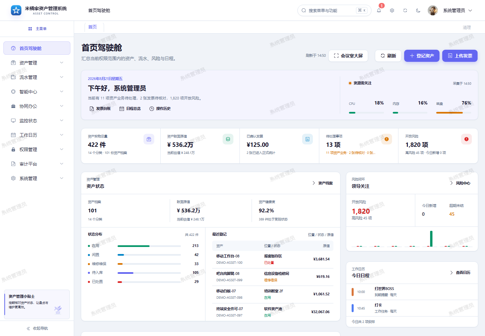
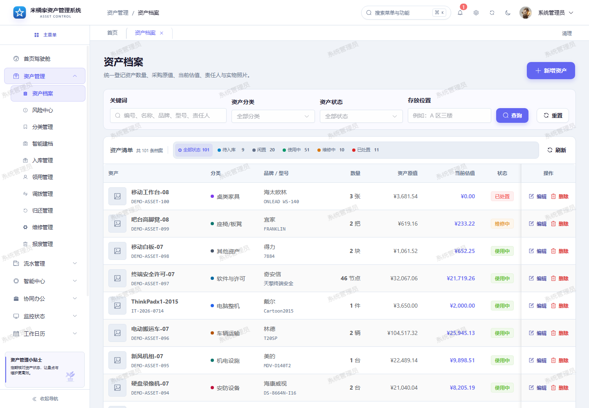
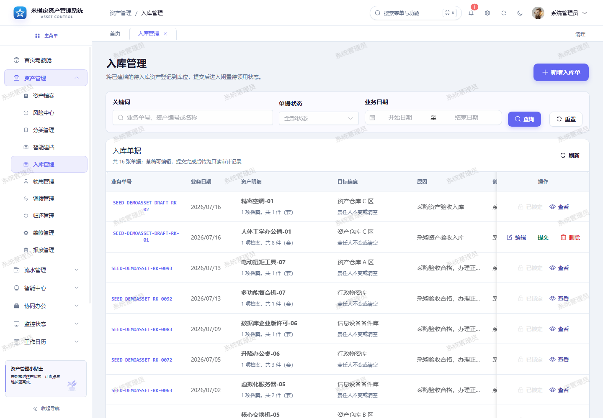
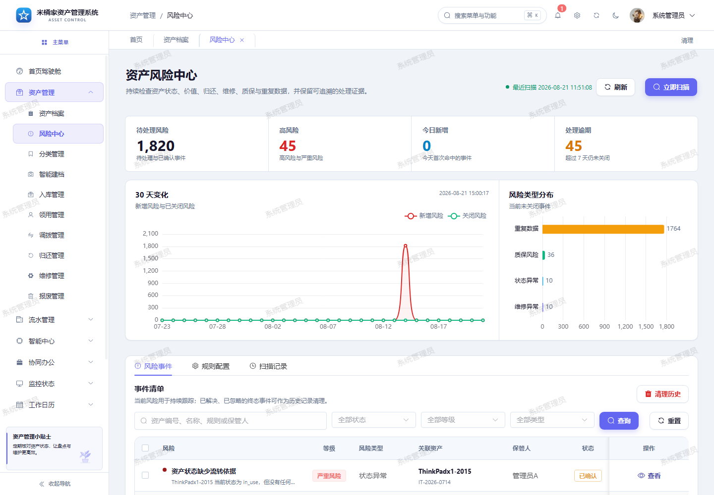
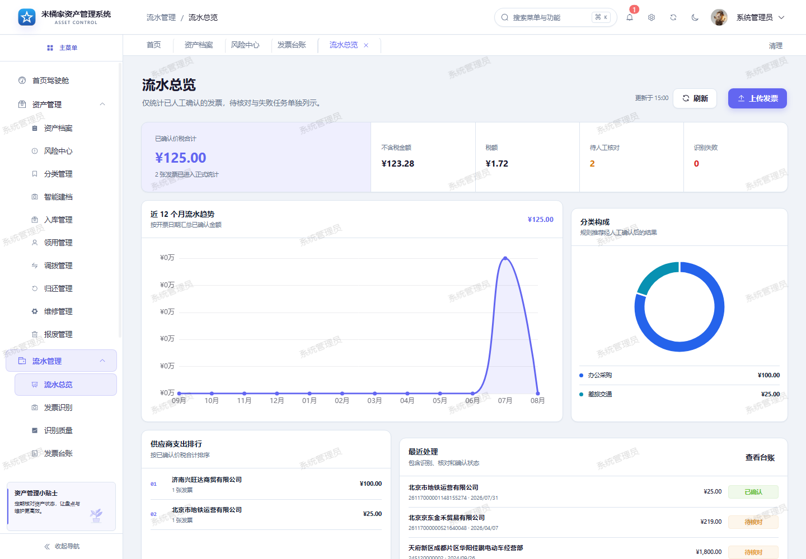
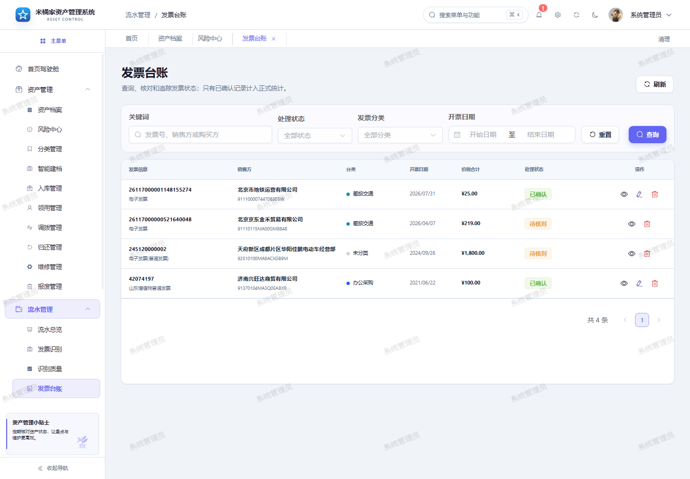
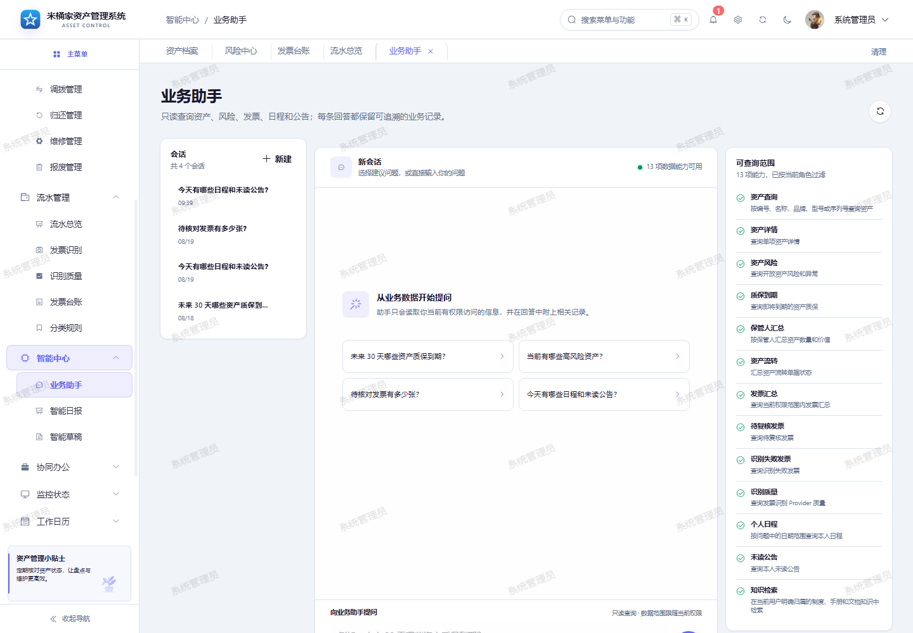
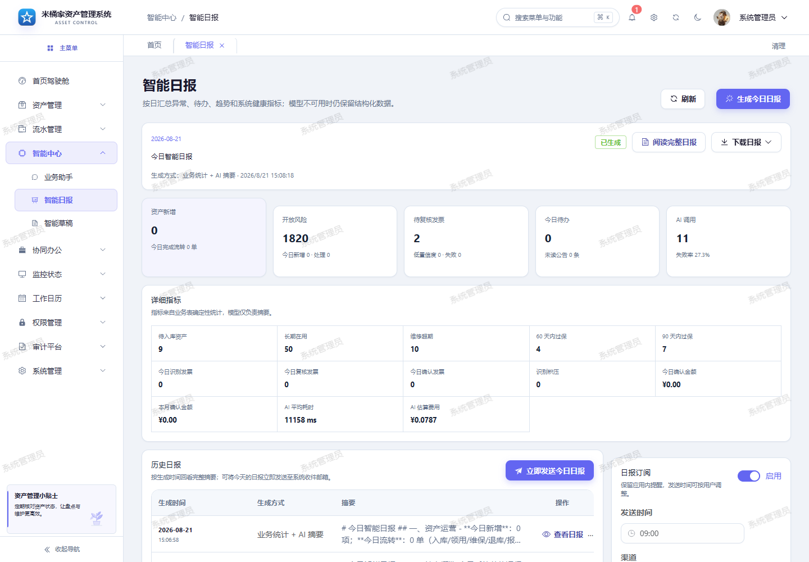
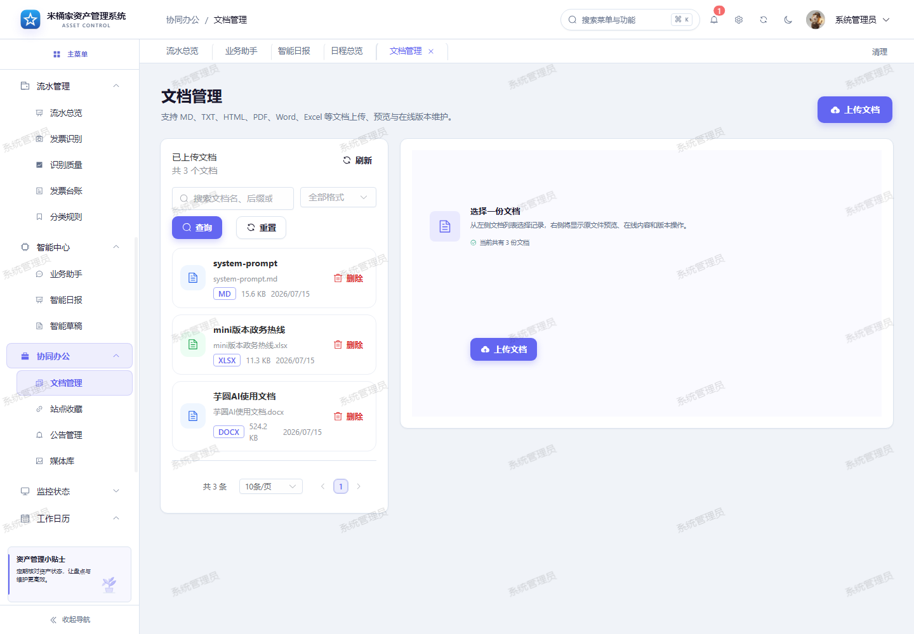
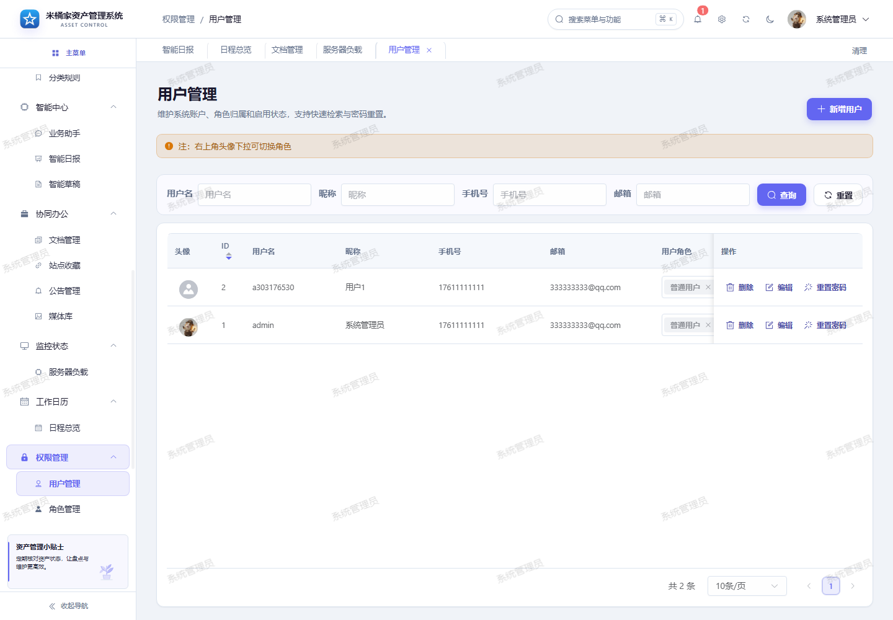

# mit-assets-admin 产品说明书

> 文档版本：1.4｜应用版本：`2.9.2`｜更新时间：2026-11-27
>
> 本文以当前仓库代码、部署脚本、`docs/images/readme/` 截图和运行时接口约定为依据。截图采集于 2026-08-21，画面中的账号、金额、日期与统计值属于演示数据；系统名称、Logo、背景和主题由部署环境里的品牌配置决定。

---

## 1. 产品概述

### 1.1 产品名称

**mit-assets-admin（资产管理中心）**。代码默认系统名称为 `mit-assets-admin`，默认副标题为 `ASSET CONTROL`；管理员可在“系统管理 → 平台设置 → 登录外观”中调整。

### 1.2 产品定位

面向企业内部行政、IT、运维、财务和综合管理场景，统一管理资产生命周期、发票与流水、知识文档、个人日程、常用站点和内部公告。系统通过业务单据、角色权限、操作审计、对象存储、可恢复后台任务和受控 AI 能力，把分散的录入、复核、查询、统计动作收拢到同一条可追溯链路。

### 1.3 核心价值

1. 建立统一、可查询、可审计的资产台账。
2. 用标准业务单驱动资产状态，保持档案与流转记录一致。
3. 将发票证据、识别结果、人工审核、验真、分类和统计串成闭环。
4. 集中文档、站点、公告和个人日程，减少工作入口切换。
5. 通过 RBAC、API 权限、操作日志、登录日志和业务快照保持系统可管可查。
6. 通过 Docker Compose、构建脚本和 `release-acceptance.sh` 形成可重复交付链路。

### 1.4 界面导览

> 完整截图画廊见 [项目总览](../README.md#2-界面一览)，本节保留业务主链路的代表界面。

<p align="center">
  <a href="images/readme/production-login.png">
    
  </a>
</p>

| 首页驾驶舱 | 资产档案 |
| --- | --- |
| [](images/readme/02-dashboard.png) | [](images/readme/asset-inventory.png) |
| 资产、票据、待办、风险、日程、资源状态聚合 | 关键词、分类、状态、位置筛选，展示数量与价值 |

| 入库管理 | 资产风险中心 |
| --- | --- |
| [](images/readme/asset-inbound.png) | [](images/readme/asset-risk.png) |
| 草稿可编辑，提交后形成只读审计记录 | 趋势、类型分布、规则配置、扫描记录与处置清单 |

| 流水总览 | 发票台账 |
| --- | --- |
| [](images/readme/invoice-dashboard.png) | [](images/readme/invoice-ledger.png) |
| 已确认金额、趋势、分类构成与供应商支出 | 识别状态、复核、确认、分类、金额与证据追踪 |

| 业务助手 | 智能日报 |
| --- | --- |
| [](images/readme/smart-copilot.png) | [](images/readme/smart-report-late.png) |
| 会话、推荐问题与按角色过滤的查询范围 | 业务指标、AI 摘要、订阅、投递记录与导出 |

| 文档管理 | 用户管理 |
| --- | --- |
| [](images/readme/documents.png) | [](images/readme/user-management.png) |
| 多格式上传、预览与在线版本维护 | 账户、角色归属、启停状态与密码重置 |

<p align="center">
  <a href="images/readme/production-login-tablet.png">
    
  </a>
</p>

<p align="center"><sub>900×900 窄桌面：登录区保持完整，品牌插画按视口裁切。</sub></p>

---

## 2. 目标用户

| 用户 | 主要职责 |
| --- | --- |
| 系统管理员 | 用户、角色、菜单、API、字典、参数、外观、SMTP 与 AI 运行配置 |
| 资产管理员 | 分类和位置、资产建档、六类流转业务单、价值统计、风险处置 |
| 财务 / 票据人员 | 发票上传、识别复核、验真、分类、确认和流水统计 |
| 文档管理员 | 文档上传、预览、在线内容维护、媒体资源维护 |
| 公告管理员 | 公告草稿、发布、附件和通知触达 |
| 普通用户 | 查询授权数据、维护个人日程、处理本人通知 |
| 审计人员 | 查看操作历史、登录日志、错误日志和业务快照 |

---

## 3. 产品信息架构

```text
首页驾驶舱
资产管理
├─ 资产档案
├─ 资产风险中心
├─ 分类管理
├─ 智能建档
├─ 入库管理
├─ 领用管理
├─ 调拨管理
├─ 归还管理
├─ 维修管理
└─ 报废管理
流水管理
├─ 流水总览
├─ 发票识别
├─ 识别质量
├─ 发票台账
└─ 分类规则
智能中心
├─ 业务助手
├─ 智能日报
└─ 智能草稿
协同办公
├─ 文档管理
├─ 站点收藏
├─ 公告管理
└─ 媒体库
监控状态
└─ 服务器负载
工作日历
└─ 日程总览
权限管理
├─ 用户管理
├─ 角色管理
├─ API 管理
└─ 菜单管理
审计平台
├─ 操作历史
├─ 登录日志
└─ 错误日志
系统管理
├─ 基础数据
│  ├─ 数据字典
│  └─ 系统参数
├─ 平台设置
│  ├─ 登录外观
│  └─ 运行配置
├─ 开放与运维
│  ├─ 接口令牌
│  └─ 配置版本
└─ 智能服务
   └─ 智能能力配置
```

菜单可见性由角色菜单权限控制；接口调用由 Casbin API 权限控制，业务行范围由 Tenant / Department / Data Scope 控制。页面可见与接口可调用是两层独立判断。

---

## 4. 功能范围

### 4.1 首页驾驶舱

首页集中呈现资产健康度、关键价值指标、最近登记资产、流转草稿或待办摘要、发票摘要、风险统计、个人工作日程和系统资源状态。首页回答“当前资产情况怎样、最近发生了什么、今天需要做什么”，各业务模块保留完整统计与明细。

### 4.2 资产可视化

资产统计包括档案数量与实物数量、分类数量、资产原值、当前估值、价值减少额、分类价值、分类数量、资产状态构成、资产位置排行和最近登记资产。

### 4.3 资产分类与位置

分类支持名称、编码、颜色、说明、排序和启停。位置字典覆盖入库、使用、调入、归还、维修和处置六类；停用位置从新业务单选项中移除，历史单据保留文本快照。

### 4.4 资产档案

每条资产档案记录资产编号、名称、分类、品牌、型号、序列号、数量、单位、采购单价、原值、当前估值、状态、位置、保管人、供应商、购置日期、质保日期、多张照片和备注。

系统按“数量 × 采购单价”计算资产原值。新建档案默认 `pending_inbound`，通过入库单后成为 `idle`。

### 4.5 资产流转

入库、领用、调拨、归还、维修和报废使用统一业务单模型，包含业务日期、目标位置、目标保管人、原因、备注和资产明细。

核心规则：

- 草稿阶段保持资产档案原状，草稿可编辑和删除。
- 单张单据最多选择 100 项资产。
- 提交时锁定资产，在事务内校验状态并更新档案。
- 每次提交写入不可变前后快照。
- 报废后资产进入 `retired`，当前估值归零。
- 已产生正式流转记录的资产进入保留态。
- 当前以整条资产档案为流转单位，按整条记录处理数量。

### 4.6 发票识别与流水

流水管理包含发票单文件或批量上传、原始证据文件存储、OCR / 多模态识别任务与失败重试、字段复核、验真与差异记录、验真历史、发票确认、管理员重开、已确认防重、分类规则、自动分类、流水总览和正式台账。

`confirmed` 发票进入正式统计。金额使用整数“分”存储，避免浮点累计误差。识别和验真能力依赖部署环境配置的提供方，系统通过能力接口展示可用状态。

### 4.7 文档中心

文档中心提供文件上传和对象存储、Word / Excel / PDF / Markdown / 文本预览、Markdown / 文本 / 富文本 / Excel 在线编辑、标题与备注保存、原始文件读取和删除。

原始证据文件与在线编辑内容分开保存，在线内容保存在独立版本。列表返回轻量元数据，正文按需加载。

### 4.8 工作日历

个人工作日历提供月历浏览、当天日程、快速新增、标题 / 日期 / 时间 / 类型 / 备注、每日 / 每周 / 每月重复规则、旧浏览器本地日程一次性导入、持久化提醒收件箱、单条已读和全部已读。

日程数据按用户隔离，服务端以登录身份确定归属。

### 4.9 站点收藏

维护常用 HTTP / HTTPS 工作入口：名称、URL、分类、说明、颜色、排序和启停。打开站点累计访问次数并更新最近访问时间。

### 4.10 公告中心

公告支持草稿、发布、编辑、删除、附件、通知列表和跨设备已读状态。发布后在线用户通过 SSE 收到提醒；离线用户下次登录后读取未读公告。

### 4.11 媒体库

媒体库接收图片，用于头像、资产照片、文档插图和登录外观。文件统一进入 S3 兼容对象存储，服务端校验格式、MIME 和大小。

### 4.12 服务器负载

监控页面按选定周期采集 CPU、内存、系统负载、磁盘、主机、内核、Go runtime、Goroutine、运行时长和当前页面内的最近趋势。

### 4.13 登录外观

登录外观支持上传并应用登录图标、恢复默认图标、维护登录背景图库、选择并激活背景、删除未使用背景。当前图标和背景通过公开只读接口提供给登录页，写操作受管理员 API 权限与操作审计控制。

### 4.14 权限与审计

- 用户、角色、菜单、API 和按钮权限。
- JWT 登录和 Casbin 路径 / 方法授权。
- 关键写操作记录。
- 登录日志、错误日志和业务审计快照。
- API Token、字典、参数、版本和运行配置管理。

### 4.15 智能建档与资产风险中心

智能建档从多照片或铭牌识别候选字段，展示置信度、分类映射和序列号去重结果，经人工确认后写入正式档案。

资产风险中心按确定性规则执行定时或手动扫描，输出趋势、类型分布、证据、处置日志、失败续扫、高风险通知、批量清理和扫描记录。扫描按批次提交，业务指纹保证幂等。

### 4.16 业务助手条件查询

业务助手以自然语言组合资产日期、金额、状态、部门和保管人条件，执行排序与分组统计。明确问法由规则解析，复杂问法使用已配置模型；实际查询与统计由数据库完成，结果展示筛选条件与资产引用。条件缺失或口径含糊时展示澄清提示。质保日期空值、记录数与实物数量分别处理。详见 [用户手册](USER-GUIDE.md#业务助手)。

### 4.17 智能日报与智能草稿

智能日报汇总当日与历史指标，覆盖资产、风险、发票、日程、公告和 AI 调用；支持订阅、站内投递、邮件投递、导出、投递记录和重试状态。模型不可用时仍保留结构化业务指标。

智能草稿从公告提取日程，或生成资产运营业务单草稿；人工确认后写入正式记录，草稿保留来源、有效期和并发保护。

### 4.18 AI 能力配置与识别质量

AI 能力配置覆盖 Provider、模型、Prompt 版本、配额、预算、超时和调用审计。识别质量页面按 Provider、模型、文件类型、字段修改、分类接受、失败、耗时和估算费用展示指标。

---

## 5. 核心业务流程

### 5.1 资产建档与入库


### 5.2 资产领用与归还

1. 从符合状态的资产中选择明细。
2. 领用填写责任人，可填写目标位置。
3. 提交后状态为 `in_use`。
4. 归还填写目标位置，提交后状态为 `idle` 并清空保管人。

### 5.3 发票处理


识别失败进入 `recognition_failed`，可重试。已确认发票由管理员重开为待复核状态后编辑。

### 5.4 文档协作

1. 上传原始文件。
2. 查看源文件或预览。
3. 对支持格式点击开始编辑。
4. 保存在线版本、标题和备注。
5. 原文件保持不变，可随时重新读取。

### 5.5 公告发布

1. 编辑标题、正文和附件。
2. 保存草稿或发布。
3. 已发布公告进入通知收件箱。
4. 在线用户经 SSE 接收，离线用户登录后补偿读取。
5. 用户查看后写入个人已读记录。

### 5.6 日程提醒

1. 用户创建一次性或重复日程。
2. 后台任务计算到期发生项。
3. 以“用户 + 日程 + 发生时间”幂等生成提醒。
4. 用户单条或全部标记已读。

### 5.7 业务助手查询

```text
用户问题
  → 规则规划器 / 可选模型条件解析
  → 条件校验与权限检查
  → 已注册 Business Tool 实时查询
  → 结构化结果、资产引用、审计记录
  → 可选模型润色表达
```

实时业务数据保持在业务库；知识库只保存显式归属的非结构化文本分片。

---

## 6. 数据口径

### 6.1 资产状态

| 状态 | 中文 | 进入方式 |
| --- | --- | --- |
| `pending_inbound` | 待入库 | 新建档案 |
| `idle` | 闲置 | 入库或归还 |
| `in_use` | 使用中 | 领用 |
| `maintenance` | 维修中 | 维修 |
| `retired` | 已处置 | 报废 |

调拨保持原状态，只改变位置和可选保管人。

### 6.2 发票状态

| 状态 | 中文 |
| --- | --- |
| `uploaded` | 已上传 |
| `recognizing` | 识别中 |
| `pending_review` | 待复核 |
| `confirmed` | 已确认 |
| `recognition_failed` | 识别失败 |

### 6.3 金额口径

- 资产原值 = 数量 × 采购单价。
- 资产价值减少额 = 原值 - 当前估值。
- 发票金额、税额和价税合计以整数分持久化，页面转换为元展示。
- `confirmed` 发票进入正式流水统计。

### 6.4 文件存储

- 资产图片、发票证据、文档源文件和登录背景存储于 S3 兼容对象存储。
- 数据库保存对象 key、元数据和业务关联。
- 私有证据文件通过后端权限校验后读取。
- 发票删除通过持久化清理任务补偿对象删除。

### 6.5 数据边界

Tenant 是最高业务数据归属边界。Department 描述租户内的组织层级，Role Data Scope 决定业务行范围，Casbin 决定 API / 菜单权限。三者各自独立，领域术语见 [CONTEXT.md](../CONTEXT.md)。

---

## 7. 非功能要求

### 7.1 部署基线

- 生产环境替换管理员密码、JWT key 和外部服务凭据。
- PostgreSQL、Redis 和对象存储保持内网访问。
- Web / API 通过 HTTPS 反向代理对外提供。
- 文件上传执行格式、MIME、大小和路径校验。
- 权限判断以服务端身份和策略为准。

### 7.2 性能

- 列表接口分页。
- 大字段从轻量列表中移除。
- 大文件在用户明确编辑时解析。
- 仪表盘使用服务端聚合。
- 前端静态哈希资源长期缓存，HTML 入口保持即时更新。

### 7.3 可用性

- 桌面与移动端基础可用。
- 支持亮色、暗色、可见焦点和减少动画。
- 页面提供加载、空数据、失败和无权限状态。
- 状态信息同时用文字、图标与颜色表达。

### 7.4 可维护性

- 业务功能优先使用插件结构。
- 业务规则集中于 Service。
- API、数据、部署变更同步维护文档。
- 发布以 Git commit 为唯一追踪标识。

---

## 8. 部署拓扑

```text
用户浏览器
  ↓ HTTPS
反向代理 / Web 容器 :8080
  ↓ /api
Server 容器 :8888
  ├─ PostgreSQL 14-18
  ├─ Redis 6+
  ├─ RustFS / MinIO S3 API
  └─ 可选 OCR / 验真 / 多模态服务
```

完整环境变量、备份、升级、回滚和故障处理见 [部署运维手册](DEPLOYMENT.md)；发布脚本速查见 [Docker 部署说明](../deploy/docker-dev/README.md)。

---

## 9. 后续演进条目

当前版本留待后续开放的能力：

- 盘点单据、二维码 / RFID 标签、盘盈盘亏。
- 资产折旧会计、维修费用和审批流。
- 采购、供应商、合同和库存供应链。
- 正式财务凭证、报销和 ERP 接口。
- 团队共享日历、参与人和多渠道提醒。
- 多人实时文档协作和企业全文检索。

这些条目保持菜单隐藏；领域模型、权限、状态和验收口径明确后分阶段开放。

---

## 10. 验收项

### 10.1 业务验收

- 资产六类流转覆盖允许与拦截状态。
- 草稿阶段保持资产原状，提交后资产与快照一致。
- 发票识别失败可重试，待复核可编辑，确认后防重生效。
- 已确认发票先重开再修改。
- 文档原文件与在线内容互不覆盖。
- 公告在线通知和离线未读均可恢复。
- 日程重复规则按发生项去重生成通知。
- 非管理员调用未授权 API 返回 403。

### 10.2 发布验收

- Web、API 和 `/api` 代理链路正常。
- PostgreSQL、Redis、对象存储连接正常。
- 首次初始化和重复启动均可执行。
- 缺失静态资源返回 404，保持 HTML 入口策略稳定。
- 容器重启后数据、文件和运行配置保持持久。
- `release-acceptance.sh` 返回 `0` 后标记上线成功。

---

## 11. 关联文档

| 文档 | 用途 |
| --- | --- |
| [产品简介](../PRODUCT.md) | 一页式定位、用户、界面导览和设计原则 |
| [项目总览](../README.md) | 完整截图、能力矩阵、架构、部署和文档索引 |
| [功能规格说明](FUNCTIONAL-SPECIFICATION.md) | 业务规则与状态机 |
| [用户使用手册](USER-GUIDE.md) | 页面操作与常见问题 |
| [API 接口文档](API.md) | 鉴权、统一响应与接口清单 |
| [系统架构说明](ARCHITECTURE.md) | 分层、插件、权限与数据流 |
| [数据字典](DATA-DICTIONARY.md) | 表、字段与枚举 |
| [开发维护指南](DEVELOPMENT.md) | 本地开发、测试与提交 |
| [部署运维手册](DEPLOYMENT.md) | 环境变量、升级、备份与回滚 |
| [文档中心](README.md) | 按角色组织的阅读路径 |
